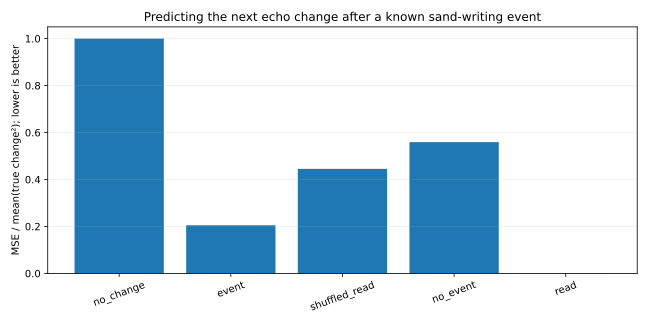
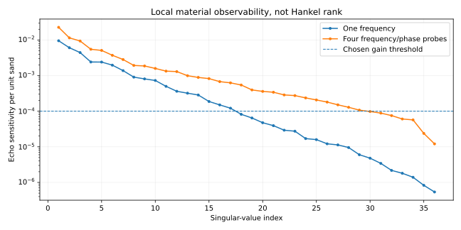
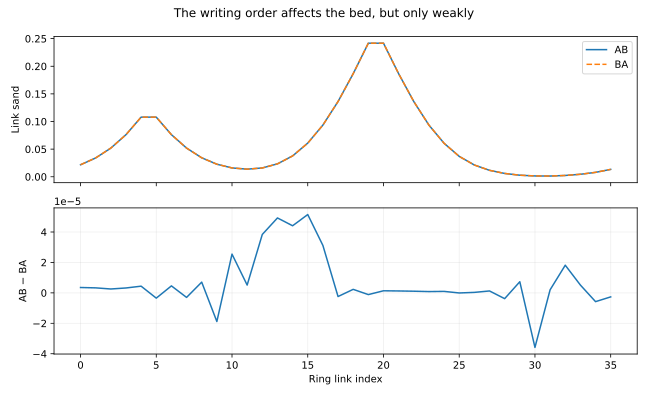

# Self-Indexing Beach

**A wave medium learns its bed; an observer learns to predict its changing answers.**

The question from the [ComputingBeach](https://github.com/anttiluode/ComputingBeachClaude) → [NeuronBeach](https://github.com/anttiluode/NeuronBeach) discussion is precise: **can a weak read reveal enough about a writable medium to predict how it will answer after the next write?** And can changing the query reveal otherwise dark directions of material memory?

This is a small, measured *first gate*, **not** an implementation of consciousness, transformer attention, a self-aware agent, or sediment fluid dynamics. The learned mirror lives **outside** the simulated beach for now. Its objective is to predict the beach's next *observable response*, not every physical degree of freedom.

## Try it

Open [`index.html`](index.html) in a browser directly (no server and no installation). Use **Write storm A/B**, **Read weak ping**, **Map read sensitivity**, **Compare AB/BA**, and switch the read frequency/phase. The ring view shows sand and waves; the sensitivity view shows which material patches affect the selected echo. The JavaScript wave rules are numerically matched to the Python model.

For quantitative figures, results, and the tests:

```bash
python -m pip install -r requirements.txt
python experiment.py
python -m pytest -q
```

All data are synthetic. `experiment.py` saves `results/summary.json` and three plots, both PNG and editable SVG. CPU only; no LLM or GPU required.

## The medium

36 water cells connected in a periodic ring. Each link has slowly writable sand `s_i` and a conductivity `c_i = c0 exp(beta*s_i)`. The wave model is discrete and deliberately dimensionless:

```text
g_i(t) = water_i(t) - water_(i+1)(t)
flux_i(t+1) = (1-friction)*flux_i(t) + c_i(s)*g_i(t)
water_i(t+1) = (water_i(t) - flux_i(t+1) + flux_(i-1)(t+1))*(1-leak)

WRITE ONLY:
s_i(t+1) = min(smax, s_i(t) + eta*max(g_i(t)^2 - threshold, 0)*(1-s_i/smax))
```

A and B are two writing wave packets, delivered at different locations and frequencies. After each event the *fast* state is reset so that only the bed carries information between events. A read is a **weak, nonwriting probe** at one common port. Four listening ports record 120 steps; we bin time into 12 windows. The current read fingerprint has 4 sensors × 12 bins × 4 phase/frequency probes = **192 values**. The source event is known to the external predictor.

## First exploratory result — one reproducible split

With `--seed 13 --train 60 --test 20 --steps 6`, using different randomly initialized beds and write histories for train and test, the fitted ridge predictor predicts the *change* in future echoes after the known next write. The scores below are MSE divided by the mean squared true echo change (lower is better):

| Predictor / control | Relative change MSE |
|---|---:|
| No change | 1.00000 |
| Event A/B only | 0.20497 |
| Current read, without knowing A/B | 0.55919 |
| Read fingerprints shuffled across training samples | 0.44520 |
| **Current read + known next A/B** | **0.000476** |

The read-conditioned model has **99.77% lower MSE than the event-only model** in this one synthetic split. It learns an external effective update model for a smooth deterministic toy, not the real beach's full internal state. No architectural tuning protocol or uncertainty intervals have yet been preregistered; treat the result as a calibration, not a generalization claim about physical reservoirs.



## What can the read actually see?

At one post-AB bed, finite-difference Jacobians of the echo with respect to each of the 36 link-sand values give:

| Observable sensitivity at a fixed absolute gain threshold of `1e-4` | Directions |
|---|---:|
| One frequency query | 17 |
| Four frequency/phase queries | 29 |

This is an **absolute-gain-thresholded local material sensitivity rank**. Its numerical value depends on sensors, query amplitudes, bins, units and the threshold. It is **not** Hankel rank, nor a proof that 29 independent memories are retrievable. Weak directions are *nearly* dark under this interface, not necessarily impossible to observe with other instruments.



On a virgin bed, writing **AB** versus **BA** produces a nonzero difference in material state (`||s_AB - s_BA|| = 1.11e-4`) but a much weaker difference in four-probe fingerprints (`||echo_AB - echo_BA|| = 3.10e-7`). This gives a deliberately hard order-read problem, not evidence that the order is reliably decodable under noise.



Frozen-bed controls preserve both sand and read responses exactly, and weak reads never write. See [`docs/EXPERIMENT.md`](docs/EXPERIMENT.md) for the distinction between material observability, predictive states, and true self-modeling.

## What would count as genuine self-indexing?

For **Gate 2**, move the querying and predictive model *inside* the loop: let a small controller store an independent prediction of a forthcoming echo, choose the next weak query based on model disagreement, compare its forecast with what the changed beach actually does, and modify future queries or the predictor. Compare against randomly chosen probes and a controller denied its archived baseline, under matched budgets.

For **Gate 3**, add Sihti-like multiscale residues and physically nonlinear phase gates: test whether phase-conditioned reads reveal order information that plain single-ping responses miss. Demand held-out histories, equal energy, no-gate and phase-shuffled controls; do not equate generic phase–amplitude coupling with content-addressable retrieval.

For **Gate 4**, replace the simplistic sand update with a defensible transport/scour law and verify stability, energetic costs, and read/write separation. Do not treat this 36-cell toy as a shallow-water PDE solver or a biological neuron.

**Useful distinction:** physical bed coordinates describe where the material is. A predictive state describes which distinctions are needed to forecast the accessible answers. The sensitivity Jacobian maps between them locally. That is the *index* we can measure.


## Gate 2A — Choose the next diagnostic ping (exploratory)

The new [active-probe benchmark](active_probe.py) introduces an **unknown localized write** at one of nine positions. An external controller uses previously calibrated response templates to identify the changed location by selecting weak diagnostic queries. Three policies receive identical archive data and post-event read budgets: a posterior-guided adaptive policy, a best-first fixed policy, and a randomized policy.

The useful finding is a **negative one**: adaptive queries did *not* reliably beat the strongest tested fixed schedule on 81 held-out synthetic beds. Both commonly beat random queries when noise was increased. This establishes an identification benchmark, **not** an embodied self-index and not an advantage for active sensing over static design.

Run locally (CPU only):

```bash
python active_probe.py --train 12 --test 81 --seed 37 --noise-ratio 1.25
python -m pytest -q
```

The eight pre-event archive measurements are shared by all methods but represent real measurement cost; the post-event query budget is 1–4. The training templates are supervised and the adaptive strategy is a coded, external policy. See [Gate 2A protocol and results](docs/GATE2.md) for the complete comparison, weaknesses, and next tests.
